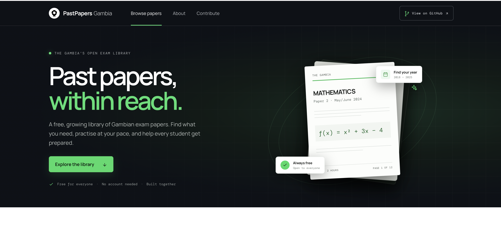

# Gambia Papers MVP

A small, responsive static website draft for an open library of Gambian national exam papers.

## Preview the site
https://five-petals.github.io/ePastPapers/

  

## What is included

- Search by subject, exam, year, session or paper
- WASSCE and GABECE filters and dynamic counts
- Sort by newest, oldest or subject
- PDF preview and download links for records with a file path
- Responsive layout for phones and desktop
- A community contribution call to action
